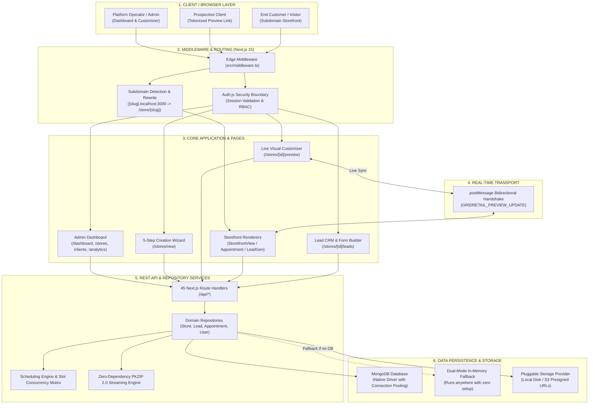
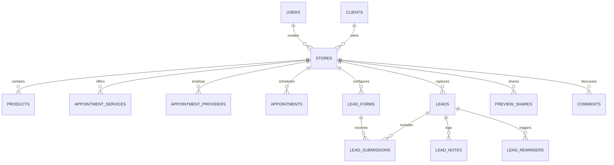

# GridRetail — Complete Project Explanation & System Guide

> **A Beginner-Friendly, Comprehensive Master Guide to GridRetail**  
> Written in clear, simple language for students, teachers, project evaluators, and software engineers.

---

## 1. What is GridRetail? (Simple Explanation)

Imagine an agency or IT company that pitches digital solutions to business clients. 
- Client A runs a **luxury jewelry boutique** and wants an **E-Commerce Store**.
- Client B runs a **legal advisory firm** and wants an **Appointment Scheduling Website**.
- Client C runs an **enterprise SaaS company** and wants a **Lead Generation & Inquiry Website**.

Normally, software teams would spend **2 to 3 weeks coding separate demo websites** from scratch for each client pitch.

**GridRetail solves this problem completely.**  
GridRetail is a **multi-tenant website generation SaaS platform**. Inside a single administrative dashboard, an operator can generate a complete, customized, fully working website in **under two minutes**, customize its design live in an interactive preview, share it securely with a client via a private link, and either publish it to a custom subdomain or export the complete code as a standalone `.zip` file!

```
                                ┌────────────────────────────────────────┐
                                │           GridRetail Dashboard          │
                                │   (Admin / Sales Engineering Team)     │
                                └──────────────────┬─────────────────────┘
                                                   │
                     ┌─────────────────────────────┼─────────────────────────────┐
                     ▼                             ▼                             ▼
        ┌─────────────────────────┐   ┌─────────────────────────┐   ┌─────────────────────────┐
        │   1. E-COMMERCE STORE   │   │ 2. APPOINTMENT WEBSITE  │   │ 3. LEAD GENERATION SITE │
        ├─────────────────────────┤   ├─────────────────────────┤   ├─────────────────────────┤
        │ • Product Catalog & PDP │   │ • Service Catalog       │   │ • Multi-Step Form       │
        │ • Category Navigation   │   │ • Practitioner Profiles │   │ • Conditional Logic     │
        │ • Slide-Out Cart Drawer │   │ • Multi-Timezone Slots  │   │ • 5 Starter Templates   │
        │ • Simulated Checkout    │   │ • Atomic Slot Locking   │   │ • Lead CRM & Kanban     │
        │ • 8 Layout Families     │   │ • Self-Cancel Link      │   │ • Excel Formula Defense │
        └─────────────────────────┘   └─────────────────────────┘   └─────────────────────────┘
```

---

## 2. The Problems GridRetail Solves

| Problem in Traditional Web Development | How GridRetail Solves It |
| :--- | :--- |
| **Repeated, Wasted Effort:** Developers keep rebuilding standard pages (heroes, headers, footers, carts, booking forms) for every client. | **Instant Multi-Type Generation:** Generates e-commerce, appointment booking, or lead generation websites in seconds with industry-tailored copy and starter assets. |
| **Broken Customizers:** In many website builders, changing a layout breaks the customer's text, or picking a dark theme turns text invisible. | **Decoupled Architecture:** Themes (colors), Layouts (structure), Sections (content blocks), and Copy (text) are independent. Changing a theme never resets copy or breaks section layouts. |
| **Double Bookings in Scheduling:** Two clients simultaneously booking the same 10:00 AM slot can cause embarrassing scheduling collisions. | **Dual-Layer Concurrency Control:** Combines an in-memory transaction lock with MongoDB unique composite compound indexes to guarantee that no slot can ever be double-booked. |
| **Form Data Lock-in & Spam:** Lead generation forms frequently receive spam submissions and risk spreadsheet formula injection attacks when exported to Excel. | **Honeypot Traps & CSV Sanitization:** Built-in hidden honeypot spam fields, immutable form version snapshots, and automatic escaping of dangerous spreadsheet formula characters (`=`, `+`, `-`, `@`). |
| **Complex Hosting & Demo Delivery:** Sharing a prototype usually requires manual cloud servers or sending static screenshots. | **Local Subdomains & 1-Click ZIP Export:** Automatic local subdomain routing (`{store-name}.localhost:3000`), secure 30-day tokenized client preview links, and zero-dependency standalone ZIP package export. |

---

## 3. High-Level System Architecture

GridRetail is built on modern industry standards using **Next.js 15 (App Router)**, **React 19**, **TypeScript 5**, **Tailwind CSS v4**, and **MongoDB**.



---

## 4. The Three Generated Website Types

### 🛍️ Type 1: E-Commerce Storefronts
For retail brands, fashion, cosmetics, electronics, and gourmet stores.
- **Product Catalog:** Category pills, SKU tagging, compare-at pricing, and discount badges.
- **Product Detail Pages (PDP):** Image zoom, variant picking, live inventory counter, and detailed description.
- **Collections:** Category filtering and sorting by price or popularity.
- **Cart & Simulated Checkout:** Slide-out animated cart drawer, composite cart keys (product + variant), order summary, and simulated one-click checkout flow with INR (`₹`) formatting.

### 📅 Type 2: Appointment Scheduling Websites
For legal advisors, medical clinics, strategy consultants, salons, coaches, and private tutors.
- **Service Catalog:** Duration in minutes, pricing (or complimentary consultations), and meeting type (In-Person, Video Conference, Phone Call).
- **Practitioner Profiles:** Assigned specialists, bios, credentials, and individual availability.
- **Timezone-Aware Calendar:** Live date picker and available time slot generation across timezones (`Asia/Kolkata`, `UTC`, `America/New_York`).
- **Atomic Slot Locking Concurrency Engine:** When a client selects a time slot, the system locks that slot with a 10-minute lease. If another client tries to book the same slot at the exact same millisecond, the second request is safely rejected. If the first client abandons the checkout, the lease expires and automatically releases the slot!
- **Self-Service Cancellation:** Clients receive a private cancellation link protected by a SHA-256 token, allowing cancellation up to the business notice deadline (e.g. 24 hours prior).

### 📋 Type 3: Lead Generation & Inquiry Websites
For B2B services, enterprise consulting, agency project intake, and quote requests.
- **5 Starter Form Templates:** General Contact, Project Quote Scope, Strategic Advisory Booking, Client Onboarding, and Event RSVP.
- **Drag-and-Drop Visual Form Builder:** Add, remove, and reorder 9 field types (Text, Email, Phone, Textarea, Select, Radio, Checkbox, Date, Number).
- **Conditional Field Logic:** Set dynamic rules (e.g., *"If Service Selected = 'Custom Web App', show Budget and Timeline fields"*).
- **Multi-Step Progression:** Form split into organized steps with step indicators and progress bars.
- **Immutable Form Versioning:** Editing a form creates a draft; the live public site stays on the published version snapshot until the administrator explicitly clicks "Publish".
- **Lead CRM Dashboard:** View incoming leads in Kanban or Table views, update status (`New`, `Contacted`, `Qualified`, `Converted`, `Lost`), add internal staff notes, and set follow-up reminders.
- **CSV Security:** Export leads to CSV with automatic defense against Excel formula injection attacks (CSV cells starting with `=`, `+`, `-`, or `@` are safely sanitized).

---

## 5. The Visual Customizer Engine

The Visual Customizer (`/stores/[id]/preview`) allows an administrator to modify a generated website and see the results **instantly inside an interactive sandbox canvas**.

```
┌──────────────────────────────────────┐     postMessage Live Sync     ┌──────────────────────────────────────┐
│       Customizer Drawer (Parent)     │ ────────────────────────────> │       Storefront Canvas (Iframe)     │
│                                      │                               │                                      │
│  [Layouts]   8 Architectural Families│                               │  • Injects CSS Custom Properties     │
│  [Themes]    12 Coordinated Palettes │                               │    (--theme-primary, --theme-surface)│
│  [Branding]  Logo, Colors, Fonts     │                               │  • Adapts Hero & Card Archetypes     │
│  [Content]   Headlines, About, CTAs  │                               │  • Renders Live Responsive Preview   │
│  [Sections]  Reorder, Add, Hide      │ <──────────────────────────── │    (Desktop, Tablet, Mobile)         │
│  [Styling]   Radius, Elevation, Form │       GRIDRETAIL_PREVIEW_ACK  │                                      │
│                                      │                               │                                      │
│  [Undo/Redo] 30 Snapshot History     │                               │                                      │
│  [Reset]     Reset to Defaults       │                               │                                      │
└──────────────────────────────────────┘                               └──────────────────────────────────────┘
```

### The 4 Pillars of Customization:
1. **Layout Family (Structure):** Defines the architectural style:
   - *Modern Minimal:* Floating navigation bar, split showcase hero, understated cards.
   - *Luxury Editorial:* Centered monogram, cinematic framed hero, 3:4 lookbook cards.
   - *Bold & Vibrant:* Announcement ticker, high-impact offset drop shadows (`4px 4px 0px #000`), block cards.
   - *Classic Commerce:* Multi-tier utility header, star ratings (`★ 4.9`), in-stock badges.
   - *Editorial Magazine:* Volume issue badge, serif typography, narrative brand story.
   - *Organic & Natural:* Curvature styling (`rounded-b-[2.5rem]`), soft rounded cards (`rounded-3xl`).
   - *Tech & Futuristic:* Technical HUD navigation, monospace tags (`SYS_ONLINE`), cyber specs.
   - *Playful & Creative:* Playful banner, asymmetric card rotation (`-rotate-3 hover:rotate-0`).
2. **Color Theme (Palette):** 12 coordinated color palettes (e.g., *Nordic Pine*, *Obsidian Slate Dark Mode*, *Terracotta Dune*, *Tokyo Neon*). Swapping a theme injects CSS custom properties without modifying section configurations or resetting text copy.
3. **Sections (Content):** 29+ modular building blocks (Hero, Best Sellers, Brand Story, FAQ Accordion, How It Works, Benefits Grid, Newsletter, Custom Footer). An administrator can drag to reorder, duplicate, hide, or edit any section.
4. **Styling Tokens (Micro-Design):** Button border radius (*Sharp*, *Rounded*, *Pill*), card elevation (*Flat*, *Bordered*, *Elevated*), form style (*Bordered*, *Filled*, *Minimal*), and shadow scale (*None*, *Subtle*, *Medium*, *Dramatic*).

---

## 6. Chronological Phase-by-Phase Development

The project was engineered through 12 rigorous phases:

```
Phase 01 ──> Phase 02 ──> Phase 03 ──> Phase 04 ──> Phase 05 ──> Phase 06
Foundation   Database &   Customizer   Export &     Analytics &  Production
Design UI    Auth Wizard  & Sharing    Delivery     Deployments  Security

Phase 07 ──> Phase 08 ──> Phase 09 ──> Phase 10 ──> Phase 11 ──> Phase 12
Retention &  Subdomain    Templates,   E-Commerce   Appointment  Lead Gen,
Persistence  Routing      Themes, SKU  PDP & Cart   Scheduling   Forms & CRM
```

- **Phase 01 — Foundation & Design System:** Scaffolding Next.js 15 App Router, establishing emerald brand colors (`#176B4D`), Geist typography, and core dashboard navigation routes (`/dashboard`, `/stores`, `/clients`, `/templates`, `/products`, `/settings`).
- **Phase 02 — Database, Auth & 5-Step Store Wizard:** Integrating MongoDB connection pooling, Auth.js credentials authentication with bcrypt password hashing, a 5-step wizard to create stores, and the initial preview sandbox.
- **Phase 03 — Visual Customizer & Client Preview Sharing:** Building the 3-panel live customizer with real-time `postMessage` synchronization, secure 30-day tokenized client preview links, and client approval/feedback drawers.
- **Phase 04 — Standalone ZIP Export & Presentation Deck:** Implementing a zero-dependency streaming PKZIP 2.0 engine to download a store as standalone static HTML/CSS/JS, transactional notification emails, and a full-screen sales presentation mode (`/stores/[id]/present`).
- **Phase 05 — Analytics, Staging Deployments & RBAC:** Multi-store conversion analytics, 1-click cloud staging preview deployments (Cloudflare/Vercel/S3), in-context anchored comments (clicking anywhere on a preview pins a team discussion note), and 4-tier RBAC (`admin`, `sales_director`, `account_manager`, `employee`).
- **Phase 06 — Production Readiness & Security Remediation:** Resolving seven critical security vectors (path traversal in zip exports, SVG image sanitization, anti-spoofing in client reviews, stored XSS protection, and structured logging).
- **Phase 07 — Storage Retention & Database Persistence Guard:** Preventing accidental test mock writes in production using `DatabaseUnavailableError`, automated database index synchronization (`npm run sync-indexes`), and storage artifact cleanup.
- **Phase 08 — Local Subdomain & Hostname Routing:** Implementing RFC 6761 local subdomain routing (`{slug}.localhost:3000`), Next.js edge middleware rewrites, BSON serialization normalization, and store publishing lifecycle (`Draft` -> `Published`).
- **Phase 09 — Architectural Templates, Themes & Catalog:** Building the catalog with custom product image uploads, 8 website design templates, and 12 coordinated color themes (96 valid combinations).
- **Phase 10 — Modular Section System & Complete E-Commerce:** Expanding to 29 modular section types, Product Detail Pages (PDP), collection browsing, slide-out cart drawer, and simulated checkout with INR (`₹`) currency formatting.
- **Phase 11 — Appointment Scheduling System:** Adding the second website type (`websiteType === "appointments"`), practitioner profiles, calendar availability, atomic slot locking concurrency control, and self-service cancellation.
- **Phase 12 — Lead Generation Website Generator, Form Builder & CRM:** Adding the third website type (`websiteType === "lead_gen"`), 5 starter form templates, drag-and-drop form builder, conditional field logic, immutable version snapshots, lead CRM with Kanban/Table views, CSV import/export, and formula injection defenses.
- **Visual Design & Customizer Overhaul:** Unifying all 8 layout families and 12 themes across all three website models, adding an Undo/Redo stack (30 snapshots), Reset to Template Defaults, root CSS custom variables, and verifying all **307 automated tests**.

---

## 7. Database Design & Repositories

GridRetail uses a clean **Repository Pattern** on top of the native MongoDB driver:



### Key Collections & Models:
1. **`users` (`UserRepository`):** System operators (`name`, `email`, `passwordHash`, `role`, `status`).
2. **`clients` (`ClientRepository`):** Corporate clients (`company`, `contactName`, `email`, `storeCount`).
3. **`stores` (`StoreRepository`):** Generated websites (`name`, `slug`, `websiteType`, `templateId`, `themeId`, `branding`, `enabledSections`, `orderedSections`, `sections`, `styling`, `status`).
4. **`products` (`ProductRepository`):** Catalog inventory (`name`, `price`, `compareAtPrice`, `sku`, `category`, `imageUrl`).
5. **`appointment_services` (`ServiceRepository`):** Bookable services (`name`, `durationMinutes`, `price`, `meetingType`).
6. **`appointment_providers` (`ProviderRepository`):** Practitioners (`name`, `role`, `email`, `serviceIds`).
7. **`appointments` (`AppointmentRepository`):** Bookings (`startUtc`, `endUtc`, `customerName`, `customerEmail`, `confirmationNumber`, `cancellationTokenHash`, `status`).
8. **`lead_forms` (`LeadFormRepository`):** Form configurations (`steps`, `settings`, `currentDraft`, `publishedVersion`, `publishedSteps`).
9. **`leads` (`LeadRepository`):** CRM records (`fullName`, `email`, `phone`, `status`, `submissionCount`, `tags`).
10. **`lead_submissions` (`LeadSubmissionRepository`):** Immutable submission logs with original field snapshots.
11. **`preview_shares` (`PreviewShareRepository`):** Tokenized sharing windows (`tokenHash`, `expiresAt`, `isRevoked`).
12. **`comments` (`CommentRepository`):** In-context anchored notes (`anchorX`, `anchorY`, `sectionId`, `message`).

> **Dual-Mode Database Highlight:** If MongoDB is connected via `MONGODB_URI`, GridRetail operates as a full production database. If `MONGODB_URI` is omitted during local development or evaluation, the repositories automatically fall back to an in-memory mock database. You can run and evaluate the entire system with zero setup!

---

## 8. Security & Data Protection Features

1. **Role-Based Access Control (RBAC):** Four discrete roles (`admin`, `sales_director`, `account_manager`, `employee`) enforced on both the client UI and server-side route handlers via `canAccessStore` and `hasCapability`.
2. **Subdomain Security Boundaries:** The middleware prevents clients from accessing internal admin pages (`/dashboard`, `/settings`) through storefront subdomains.
3. **Double Booking Prevention:** Atomically acquires temporary slot locks with automated rollback on failure and a 10-minute lease cleanup timer.
4. **Honeypot Anti-Spam:** Public lead forms include a hidden honeypot field (`website_hp`). Bots that fill out this field are silently rejected without polluting the CRM database.
5. **Excel Formula Injection Protection:** When exporting leads to CSV, cells that begin with dangerous formula triggers (`=`, `@`, `+`, `-`) are prepended with an apostrophe (`'`) to neutralize script execution in Microsoft Excel.
6. **Tokenized Preview Sharing:** Client preview links utilize high-entropy cryptographic tokens hashed using SHA-256 with strict expiration and instant revocation support.
7. **Production Write Guard:** In production environments (`NODE_ENV === "production"`), the platform throws a `DatabaseUnavailableError` if the database connection drops, preventing mock data from contaminating production.

---

## 9. Verification & Quality Gates

The entire repository adheres to strict automated quality gates:

```
[Quality Gate 1: Type Checking]    npm run type-check   ──> 0 Errors (Strict TypeScript 5)
[Quality Gate 2: Code Linting]     npm run lint         ──> 0 Errors (ESLint 9)
[Quality Gate 3: Automated Tests]  npm test             ──> 307 / 307 Tests Passing (22 Suites)
[Quality Gate 4: Production Build] npm run build        ──> Success (All 25 Routes Compiled in ~15s)
```

### Automated Test Coverage (307 Tests):
- `tests/visual-design-system-overhaul.test.ts`: Layout families, theme tokens, styling tokens, and round-trip persistence.
- `tests/phase12-lead-gen.test.ts` & `tests/phase12-csv.test.ts`: Lead forms, multi-step validation, and CSV formula defense.
- `tests/phase11-concurrency.test.ts` & `tests/phase11-appointments.test.ts`: Atomic slot locking, race conditions, and timezone conversions.
- `tests/auth.test.ts` & `tests/permissions.test.ts`: Password hashing, JWT sessions, and RBAC matrix.
- `tests/subdomains.test.ts`: Subdomain parsing and URL normalization.
- `tests/delivery.test.ts` & `tests/security.test.ts`: PKZIP export integrity and path traversal prevention.

---

## 10. How to Run & Demonstrate the Project (Step-by-Step)

### Step 1: Start the Application
Open your terminal in `D:\grid`:
```bash
# Install dependencies (if not already installed)
npm install

# Run the local development server
npm run dev
```
Open **[http://localhost:3000](http://localhost:3000)** in your browser.

### Step 2: Log In
On the login screen, click the **"Admin Quick Fill"** button (or enter):
- **Email:** `admin@gridretail.internal`
- **Password:** `AdminGrid2026!`
Click **Sign In** to access the GridRetail Dashboard.

---

### Step 3: Choose Your Live Demo Scenario

#### 🌟 Demo Scenario A: The E-Commerce Storefront
1. Navigate to **Stores** in the sidebar.
2. Click on an existing e-commerce store (e.g., **Aura Minimalist Living**) or click **"+ New Store"** to create one.
3. Click **"Open Customizer"** (`/stores/[id]/preview`).
4. **Demonstrate Design Switching:**
   - Click the **Layout** tab and choose **"Bold & Vibrant"** &rarr; Notice the offset drop shadows and uppercase promo badges appear immediately!
   - Click **"Luxury Editorial"** &rarr; Notice the serif typography, centered monogram header, and 3:4 portrait cards!
   - Click the **Themes** tab and select **"Obsidian Slate"** &rarr; The store seamlessly switches to high-end dark mode!
   - Click the **Undo** button (`↶`) in the customizer header &rarr; Watch the store instantly roll back to the previous state!
5. **Demonstrate E-Commerce Shopping:**
   - In the canvas or on the subdomain (`aura-minimalist.localhost:3000`), click **"Quick Add"** on a product.
   - Open the slide-out cart drawer, review the items in INR (`₹`), and proceed to the simulated checkout page.

#### 🌟 Demo Scenario B: The Appointment Scheduling Website
1. Go to **Stores** &rarr; Open an appointment website (e.g., **Apex Health Clinic** or **Chambers Advisory**).
2. Click **"Open Subdomain"** or navigate to its public storefront.
3. **Demonstrate Appointment Booking:**
   - Select a service (e.g., *"Comprehensive Legal Strategy Consultation"*).
   - Select an available date on the calendar.
   - Click an available time slot (e.g., *10:00 AM*).
   - Fill in customer details: Name (`Rajesh Sharma`), Email (`rajesh@example.com`).
   - Click **"Confirm Appointment"**.
   - An instant confirmation modal appears with a unique booking reference code (e.g. `APT-SIM-829104`) and a private self-service cancellation link!
4. **Demonstrate Concurrency Safety:**
   - Explain to your teacher: *"If another user tries to book that exact same 10:00 AM slot, our atomic slot-locking mutex blocks them and returns an error saying the slot has just been leased."*

#### 🌟 Demo Scenario C: Lead Generation & Visual Form Builder
1. Go to **Stores** &rarr; Select a lead-generation website (or click **"Leads & Inquiries"**).
2. Go to `/stores/[id]/leads`.
3. **Demonstrate the Visual Form Builder:**
   - Switch to the **Form Builder** tab.
   - Show the 5 starter templates (*General Contact*, *Quote Request*, *Advisory Booking*, *Onboarding*, *Event RSVP*).
   - Show how fields can have conditional rules (*"Show Budget field only if Project Type = Enterprise"*).
4. **Demonstrate Live Lead Capture:**
   - Submit a test inquiry on the storefront.
   - Return to the **Lead CRM** tab &rarr; The lead appears immediately in the **New** column of the Kanban board!
   - Drag the lead card to **"Contacted"** or **"Qualified"**.
   - Click the lead to open the slide-out drawer, add an internal consultation note, or set a follow-up reminder.
   - Click **"Export CSV"** and explain the built-in formula injection security protections.

---

## 11. Top 10 Viva Questions & Winning Answers

**Q1: What is GridRetail in one sentence?**  
*Answer:* GridRetail is a Next.js-based multi-tenant website generation platform that enables teams to create, customize, preview, and publish tailored E-Commerce, Appointment, and Lead Generation websites in minutes.

**Q2: What is the core technology stack and why was it chosen?**  
*Answer:* We use Next.js 15 App Router with TypeScript for robust full-stack React server and client components, Tailwind CSS v4 for token-based styling, Auth.js v5 for secure credential authentication, and MongoDB with a dual-mode in-memory fallback for data persistence.

**Q3: How does the live customizer communicate with the website preview without refreshing the page?**  
*Answer:* It uses a secure, bidirectional HTML5 `postMessage` protocol. When you tweak a slider or theme in the parent customizer drawer, it dispatches a `GRIDRETAIL_PREVIEW_UPDATE` message with the payload to the child iframe. The iframe updates its reactive React state and replies with a `GRIDRETAIL_PREVIEW_ACK` handshake.

**Q4: How does the system handle multi-tenancy and subdomains on localhost?**  
*Answer:* Our Next.js Edge Middleware (`src/middleware.ts`) inspects incoming `Host` headers. If a request comes in on `{store-slug}.localhost:3000`, the middleware validates the slug against reserved keywords and internally rewrites the request to `/store/{store-slug}` while maintaining isolated security boundaries.

**Q5: What is the difference between a Layout, a Theme, a Section, and Styling?**  
*Answer:*
- **Layout:** The architectural arrangement of headers, heroes, and cards (8 layout families).
- **Theme:** The color palette applied via CSS custom properties (12 coordinated color themes).
- **Section:** A distinct content block (Hero, Featured Products, FAQ, Brand Story).
- **Styling:** Micro-design tokens like button radius, card elevation, and form input styles.

**Q6: How do you prevent double bookings on appointment websites?**  
*Answer:* We implemented an atomic slot-locking concurrency engine. Before an appointment is confirmed, an in-memory mutex acquires a temporary 10-minute reservation lease on the provider-time slot, backed by a MongoDB unique compound index (`storeId + providerId + startUtc`). If two users click simultaneously, one succeeds and the other is safely rejected.

**Q7: How does form versioning work in the Lead Generation module?**  
*Answer:* Forms use an immutable versioning model. When an admin edits a form, changes are saved to an isolated `currentDraft`. The public storefront continues serving the `publishedVersion` snapshot until the admin explicitly clicks "Publish", creating a new version (v1, v2, v3) without breaking existing active submissions.

**Q8: What security protections are implemented for CSV exports?**  
*Answer:* We protect against CSV Formula Injection (CWE-1236). Attackers sometimes submit lead names starting with `=`, `+`, `-`, or `@` to execute malicious commands when an admin opens the CSV in Excel. Our CSV generator automatically detects these characters and prepends a sanitizing single quote (`'`).

**Q9: What happens if MongoDB is not running on my computer?**  
*Answer:* GridRetail features an intelligent dual-mode database architecture. In development mode, if `MONGODB_URI` is not configured, the repositories automatically fall back to an in-memory mock database seeded with rich demonstration data. In production mode, it enforces strict persistence and throws a `DatabaseUnavailableError`.

**Q10: How was the project tested and verified?**  
*Answer:* We maintain a test suite of **307 automated tests across 22 test suites** using the Node.js native test runner via `tsx`. It covers unit tests, integration tests, concurrency race-condition tests, security audits, and full end-to-end user journeys.

---

## 12. Summary for Presentation

When presenting GridRetail to your evaluation panel:
1. **Start with the Problem:** Explain how building separate demo websites for sales pitches wastes hundreds of engineering hours.
2. **Show the Solution:** Open GridRetail, log in, and show the clean dashboard.
3. **Highlight the Architecture:** Draw the 3 website types on the whiteboard (E-Commerce, Appointments, Lead Gen) and explain how the visual customizer, `postMessage` protocol, and MongoDB repositories work together.
4. **Perform a 60-Second Demo:** Switch layouts live, make an appointment booking, and capture a test lead in the CRM.
5. **Close with Technical Rigor:** Mention the dual-layer slot-locking engine, CSV formula injection sanitization, RFC 6761 subdomain routing, and 307 passing automated tests.

---
*Created for GridRetail Project Evaluation & Architectural Review.*
