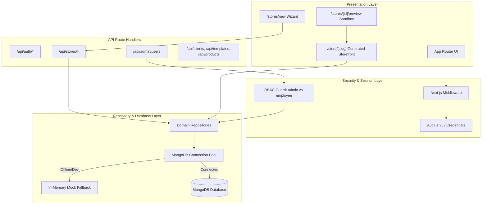

# GridRetail — Architecture Blueprint

## 1. System Vision & Purpose

GridRetail is an internal SaaS platform designed to accelerate sales cycles by generating customized, high-fidelity e-commerce demo storefronts for prospective clients within minutes.

Instead of manual design mockups, platform operators follow an intuitive wizard:
1. Choose a client or create a new prospect record.
2. Choose an industry-specific storefront template.
3. Configure branding (color palette, typography, value propositions).
4. Select sample products from the catalog.
5. Review configuration and deploy the generated storefront.
6. Preview the resulting storefront in a live, responsive sandbox.

---

## 2. Phase 2 Architecture Overview

Phase 2 transforms the Phase 1 UI shell into a full-stack, database-backed platform with robust authentication, role-based access control, persistent store generation, and a live rendering engine.



### Key Architectural Pillars:

1. **Decoupled Presentation Layer:**
   - Next.js App Router with React Server and Client Components.
   - Reusable UI primitives (`Button`, `Card`, `Badge`, `SearchInput`, `FilterSelect`, `Modal`, `EmptyState`) located in `@/components/ui`.
   - Domain-specific presentation components (`MetricCards`, `RecentStoresTable`, `QuickActions`, `RecentActivityFeed`) located in `@/components/dashboard`.
   - Dedicated wizard flow (`/stores/new`) isolated across 5 progressive stages.
   - Dedicated storefront rendering sandbox (`/store/[slug]`) isolated from the administrative `AppShell`.

2. **Database & Persistence Layer:**
   - Native MongoDB driver (`mongodb@7.x`) with global client promise caching across Next.js App Router hot reloads.
   - Repository Pattern (`StoreRepository`, `ClientRepository`, `TemplateRepository`, `ProductRepository`, `UserRepository`, `ActivityRepository`) abstracting MongoDB queries.
   - Graceful in-memory fallback enabled whenever `MONGODB_URI` is unconfigured, ensuring test suites and local sandboxes run without crashing.
   - Unique indexes enforcing integrity on `stores.slug`, `stores.id`, `users.email`, `templates.id`, `clients.id`, and `products.id`.

3. **Authentication & Role-Based Access Control:**
   - Auth.js (`next-auth@5.0.0-beta.32`) utilizing Credentials Provider with `bcryptjs` password verification (minimum cost factor 10).
   - JWT sessions with 8-hour expiration (`maxAge: 28800`).
   - Server-side role validation distinguishing `admin` (full permissions + user provisioning) and `employee` (store creation and storefront operations).
   - Edge-compatible Next.js Middleware guarding `/dashboard`, `/stores`, `/clients`, `/templates`, `/products`, and `/settings`.
   - Public routing allowed for `/login`, `/store/*`, `/api/auth/*`, and `/api/health`.

4. **Store Generation Pipeline:**
   - Slug normalization utility converting raw store names to lowercase URL-safe slugs with hyphens and reserved keyword protection (`admin`, `api`, `dashboard`, `login`, `store`, `settings`).
   - Store input validation ensuring mandatory fields, valid hex colors, and non-empty product lists.
   - One-click creation storing complete configuration documents in MongoDB and automatically incrementing client demo counts.

5. **Storefront Rendering & Device Preview Sandbox:**
   - Public route `/store/[slug]` dynamically resolves the store by slug and queries the associated product catalog.
   - Custom branding styling dynamically applied via CSS variables (`--store-primary`, `--store-secondary`) and Google Fonts.
   - Modular storefront sections rendered dynamically (Hero banner, Value propositions, Featured catalog grid, About section, Newsletter subscription, Footer).
   - `/stores/[id]/preview` provides an interactive iframe sandbox with responsive viewport controls (Desktop, Tablet 768px, Mobile 375px), refresh triggers, and pop-out preview capabilities.

---

## 3. Directory Layout & Module Boundaries

```text
src/
├── app/                  # Routing & Page Views
│   ├── layout.tsx        # Global shell with SessionWrapper
│   ├── page.tsx          # Root redirect to /dashboard
│   ├── globals.css       # Design tokens & baseline CSS
│   ├── login/            # Dedicated sign-in page with Suspense wrapper
│   ├── dashboard/        # Executive overview & KPIs
│   ├── stores/           # Store management & creation
│   │   ├── page.tsx      # Stores table with search & filters
│   │   ├── new/          # 5-step store generation wizard
│   │   └── [id]/preview/ # Responsive iframe preview suite
│   ├── store/[slug]/     # Standalone generated storefront renderer
│   ├── clients/          # Client CRM overview & contacts
│   ├── templates/        # 8-template architectural showcase
│   ├── products/         # Product catalog management
│   ├── settings/         # Tabbed workspace preferences & Team security
│   └── api/              # Secure REST API endpoints
├── components/
│   ├── layout/           # AppShell, AppSidebar, AppHeader, PageHeader
│   ├── dashboard/        # Dashboard-specific widgets & tables
│   ├── ui/               # Low-level reusable UI primitives
│   └── shared/           # Cross-cutting widgets (StatusBadge, SessionWrapper)
├── config/               # Site configuration & design tokens
├── constants/            # Navigation structure & route metadata
├── lib/
│   ├── db/               # mongodb connection pool, seed & bootstrap scripts
│   ├── repositories/     # Domain repositories with MongoDB & fallback logic
│   └── validation/       # Validation schemas for store, slug, and user
├── types/                # TypeScript interface contracts
├── auth.ts               # Auth.js configuration & credentials provider
└── middleware.ts         # Route protection middleware
```

---

## 4. Security & Compliance Guardrails

1. **Credential Safety:** Passwords hashed with `bcryptjs` (salt rounds 10). Passwords are never stored in plain text and are stripped before returning user entities to the client (`SafeUser`).
2. **Server-Side Authorization:** Admin-only routes (`/api/admin/users`) strictly verify `session.user.role === "admin"` on the server before mutating user records.
3. **Disabled Account Invalidation:** If an administrator disables an employee account, the credentials provider blocks login immediately with `ACCOUNT_DISABLED`.
4. **Input Sanitization:** Slugs and store attributes are sanitized against XSS and injection patterns. Slugs cannot collide with reserved routing pathways.
5. **Session Isolation:** Storefront previews render in an iframe sandbox (`sandbox="allow-scripts allow-same-origin"`) without inheriting administrative session tokens.
