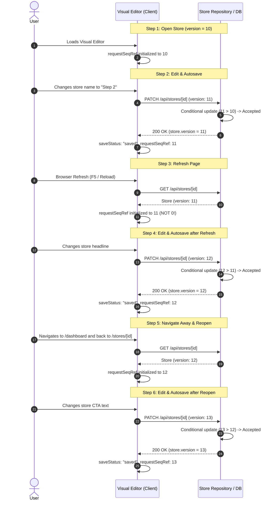
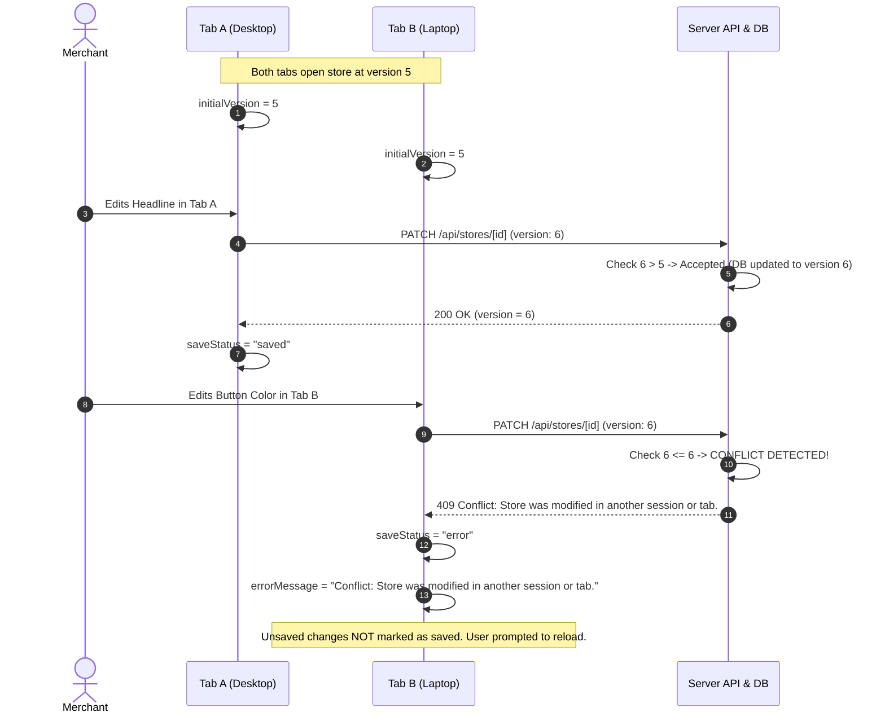

# GridRetail — Phase 15.1.1.4: Version Lifecycle & Multi-Tab Audit

## Executive Summary

This audit assesses the visual editor's revision sequencing across its complete lifecycle, covering initial load, debounced autosave, page refresh, unmount navigation, and multi-tab concurrent edits.

---

## 1. Sequence Initialization Bug & Fix

### The Prior Bug
In Phase 15.1, `useEditorHistory` hardcoded the client sequence counter:
```typescript
// DEFECT: Hardcoded counter reset to 0 on every mount
const requestSeqRef = useRef<number>(0);
```

When an existing store with persisted `version = 10` was loaded:
1. Store loaded with `store.version = 10`.
2. User made an edit in the Visual Editor.
3. Autosave triggered with `version = ++requestSeqRef.current` (evaluating to `version: 1`).
4. Server received `version: 1` on a store with `version: 10`.
5. The stale protection guard rejected the save (`1 <= 10`), discarding the user's legitimate edits!

### The Implemented Fix
`VisualEditorWorkspace` and `useEditorHistory` now bind directly to the store's persisted version:

```typescript
// VisualEditorWorkspace.tsx
const { ... } = useEditorHistory({
  storeId: store.id,
  initialSnapshot: createSnapshot(),
  initialVersion: store.version || 0,
  onApplySnapshot: handleApplySnapshot,
  onStorePersisted: handleStorePersisted,
  debounceMs: 2500,
});
```

```typescript
// useEditorHistory.ts
export function useEditorHistory({
  storeId,
  initialSnapshot,
  initialVersion = 0,
  onApplySnapshot,
  onStorePersisted,
  debounceMs = 2500,
}: UseEditorHistoryOptions) {
  // Initialized from the store's persisted version to prevent sequence resets across reloads/remounts
  const requestSeqRef = useRef<number>(initialVersion);
  const lastHandledSeqRef = useRef<number>(initialVersion);
  const lastSavedVersionRef = useRef<number>(initialVersion);
  ...
```

When a save succeeds, the server returns the updated store with its new version, which updates the sequence refs and propagates via `onStorePersisted`:
```typescript
const resData = await res.json().catch(() => ({}));
if (resData.store && typeof resData.store.version === "number") {
  requestSeqRef.current = Math.max(requestSeqRef.current, resData.store.version);
  lastSavedVersionRef.current = resData.store.version;
  if (onStorePersisted) {
    onStorePersisted(resData.store);
  }
}
```

---

## 2. 6-Step Persistence Lifecycle Verification

The exact 6-step lifecycle required by the specification was verified through automated test case 4 in `tests/phase15-1-1-4-concurrency.test.ts`:



### Lifecycle Test Assertion Results:
- **Step 1:** Store initialized at `version = 10` -> Verified.
- **Step 2:** Edit committed with `version = 11` -> Verified.
- **Step 3:** Refresh sequence starts at `11` -> Verified.
- **Step 4:** Post-refresh edit committed with `version = 12` -> Verified.
- **Step 5:** Post-reopen sequence starts at `12` -> Verified.
- **Step 6:** Post-reopen edit committed with `version = 13` -> Verified.

---

## 3. Multi-Tab Conflict Detection Architecture

When two editor tabs are open simultaneously on the same merchant store:



### Protection Guarantees:
1. **No Silent Data Loss:** Tab B's edits cannot silently overwrite Tab A's edits.
2. **Explicit 409 Conflict:** The server rejects conflicting submissions with HTTP status code 409.
3. **Accurate Client Save Status:** Tab B transitions `saveStatus` to `"error"`. It never falsely displays `"saved"`.
4. **Preserved Working Draft:** Tab B retains the user's uncommitted edits in local memory rather than wiping them, allowing the user to copy them before reloading.
