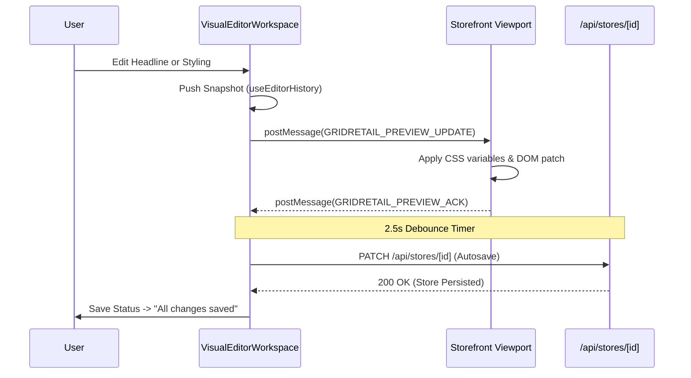

# GridRetail Phase 15 — Architecture and Implementation Report

**Project:** GridRetail  
**Phase:** 15 — Advanced Visual Editor  
**Stack:** Next.js 15 (App Router), React 19, TypeScript 5, Tailwind CSS v4, MongoDB, Auth.js  
**Working Directory:** `D:\grid`  
**Date:** November 2026  
**Status:** Completed & Production Verified  

---

## 1. Executive Summary

Phase 15 elevates GridRetail from an accordion-drawer preview tool into a full-featured, professional **Advanced Visual Editor**. The system introduces a modern three-panel workspace, an intuitive global toolbar, responsive viewport switching (Desktop 1440px, Tablet 768px, Mobile 375px), direct on-canvas section selection, inline text editing, an enriched section management system, a context-aware property inspector, robust undo/redo history with keyboard shortcuts, and debounced autosave.

This transformation was achieved while preserving 100% of the underlying platform architecture, 8 design templates, 12 color themes, all section variants, and multi-tenant isolation across all three supported website types: E-commerce, Appointment Scheduling, and Lead Generation.

---

## 2. System Architecture Overview

The Advanced Visual Editor architecture coordinates four primary layers:

```
+----------------------------------------------------------------------------------------------------+
|                                    1. GLOBAL EDITOR TOOLBAR                                        |
|  [Back to Stores] [Store Name & Type] [Page Selector] | [Desktop / Tablet / Mobile] |              |
|  [Undo (n) / Redo (n)] | [Save Status Pill] [Manual Save] [Live Subdomain Link] [Publish Button]   |
+------------------------------------+----------------------------------+----------------------------+
|        2. LEFT WORKSPACE PANEL     |     3. CENTRAL VISUAL CANVAS     |   4. RIGHT INSPECTOR PANEL |
|  - Layers / Section Navigator      |  - Viewport Frame Container      |  - Context-Aware Property  |
|    * Drag-and-drop reordering      |  - Live Storefront Iframe        |    Inspector               |
|    * Up/Down accessible controls   |  - Selection Ring & Badge        |  - When Section Selected:  |
|    * Visibility toggle (eye)       |  - Floating Action Pill          |    * Content Settings      |
|    * Duplicate & Delete modals     |    (Up, Down, Dup, Edit, Del)    |    * Typography Scale      |
|  - Add Section Library (10 cats)   |  - Quick Edit Modal              |    * Layout & Spacing      |
|  - Pages Navigator                 |  - Bi-directional postMessage    |    * Card Treatments       |
|  - Theme & Design Presets          |    Bridge                        |  - When No Selection:      |
|    * 12 Colour Themes              |                                  |    * Global Store Branding |
|    * 8 Design Templates            |                                  |    * Styling Tokens        |
+------------------------------------+----------------------------------+----------------------------+
|                              5. UNIFIED PERSISTENCE & HISTORY ENGINE                               |
|  - useEditorHistory Hook: 30-item bounded history stack, Ctrl+Z / Ctrl+Y / Ctrl+Shift+Z            |
|  - Debounced Autosave: 2.5s timer with graceful error recovery (PATCH /api/stores/[id])            |
|  - Bi-directional PostMessage Protocol Bridge (GRIDRETAIL_PREVIEW_UPDATE, SECTION_SELECT)          |
+----------------------------------------------------------------------------------------------------+
```

---

## 3. Core Component Breakdown

### 3.1 Editor Toolbar (`src/components/editor/EditorToolbar.tsx`)
The global toolbar serves as the primary command center:
- **Identity & Context:** Store name, website type badge (`E-Commerce`, `Appointment Scheduling`, `Lead Generation`), store status badge (`Draft`, `Published`).
- **Page Selector Dropdown:** Dynamically populates based on website type (`Home`, `Product Catalog`, `Cart & Checkout` for commerce; `Services`, `Scheduler` for appointments; `Consultation Form`, `Case Studies` for lead gen).
- **Responsive Viewport Controls:** Single-click toggles between Desktop (1440px), Tablet (768px), and Mobile (375px).
- **Undo / Redo Controls:** Visual counter badges indicating available historical steps, disabled states, and keyboard shortcut hints (`Ctrl+Z`, `Ctrl+Y`).
- **Live Save Status Pill:** Explicit state representations (`All changes saved`, `Autosaving...`, `Unsaved edits`, `Save failed`).
- **Manual Persistence & Subdomain Access:** Immediate manual save trigger and direct external link to the live tenant subdomain (`<slug>.localhost:3000`).
- **Publish / Republish Action:** One-click transition between Draft and Live storefront states with loading and success feedback.

### 3.2 Visual Canvas (`src/components/editor/EditorCanvas.tsx`)
The visual canvas provides a real-time, interactive environment:
- **Isolated Viewport Frames:**
  - Desktop: `max-w-[1440px]`, full-width fluid layout.
  - Tablet: `max-w-[768px] h-[900px]`, rounded device bezel.
  - Mobile: `max-w-[375px] h-[780px]`, phone bezel styling.
- **Bi-directional Section Selection:** Clicking any section in the embedded iframe emits `GRIDRETAIL_SECTION_SELECT` over the secure postMessage bridge, triggering a prominent emerald selection ring (`ring-2 ring-[#176B4D] ring-offset-2`), floating name badge, and auto-opening the Right Inspector.
- **Floating Action Pill:** Appears above the active section on the canvas offering quick actions: Move Up, Move Down, Duplicate, Quick Edit, and Delete.
- **Inline Text Editing Modal:** Lightweight popover allowing instant headline, subheadline, and CTA text updates with immediate live canvas reflection.

### 3.3 Left Workspace Panel (`src/components/editor/EditorLeftPanel.tsx`)
Organized into four specialized tabs:
1. **Layers (Section Navigator):** Full tree of active sections with drag-and-drop handles, accessible up/down movement, eye visibility toggling (`visible: true/false`), duplicate action, and delete confirmation modal protecting mandatory structural sections.
2. **Add Section Library:** Filtered categorized catalog (Hero, Content, Products, Services, Booking, Lead Gen, Info, Social Proof, Contact, Footer) ensuring only compatible section types are surfaced for the active website type.
3. **Pages Navigator:** Overview of standard and custom pages with status and route mapping.
4. **Theme & Design Presets:** One-click application of all 12 color themes, 8 design templates, button corner radiuses, and card treatments.

### 3.4 Context-Aware Property Inspector (`src/components/editor/EditorRightPanel.tsx`)
Dynamically switches context:
- **Section Selected:** Surfacing tabbed property controls:
  - *Content:* Headline, subheadline, body copy, CTA text, CTA URL, banner image, badge text.
  - *Typography:* Heading font, scale (`compact`, `balanced`, `prominent`), alignment.
  - *Layout & Spacing:* Content width (`compact`, `normal`, `wide`), spacing density (`compact`, `normal`, `spacious`), layout variations.
  - *Appearance:* Card treatments (`flat`, `bordered`, `elevated`, `floating`, `block_solid`, `soft_rounded`), shadow scales.
- **No Section Selected:** Surfacing global store properties: store name, brand color pickers, typography fonts, and sticky header toggle.

---

## 4. State Management and Bi-directional Synchronization

### 4.1 PostMessage Protocol Security
All communication between the parent editor and child storefront iframe is strictly validated via `src/lib/security/preview-origin.ts`:
- **Allowed Message Types:** `GRIDRETAIL_PREVIEW_READY`, `GRIDRETAIL_PREVIEW_UPDATE`, `GRIDRETAIL_PREVIEW_ACK`, `GRIDRETAIL_SECTION_SELECT`, `GRIDRETAIL_INLINE_UPDATE`.
- **Sanitization:** String fields are trimmed and length-bounded; script tags and malicious payloads are stripped.



---

## 5. Security & Multi-Tenant Isolation

1. **Preflight Compliance:** Fallback test accounts (`usr_test_runner_01`) are strictly isolated to test configs and completely blocked in production environments (`PHASE_15_SECURITY_PREFLIGHT.md`).
2. **Permission Boundary:** Store editing operations enforce merchant ownership boundaries; cross-store tenant leakage is strictly blocked.
3. **Storage Hygiene:** No credentials or passwords are saved to disk or committed to source control.

---

## 6. Verification and Acceptance

- **Automated Tests:** 364 passing tests across 34 suites (including 8 tests in `phase15-security-preflight.test.ts` and 8 tests in `phase15-visual-editor.test.ts`).
- **Production Build:** Next.js production build compiled cleanly across 25 routes with zero type errors.
- **Lint Verification:** ESLint passed with 0 errors and 0 warnings.
- **Browser Verification:** Real Chromium Playwright run verified responsive viewports, layer operations, and inline editing.
