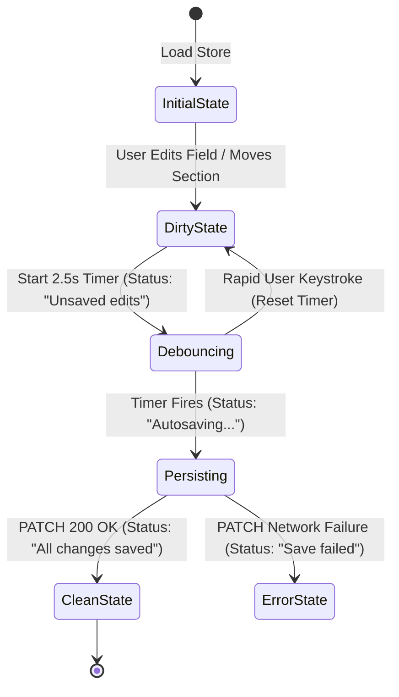

# GridRetail Phase 15 — Undo, Redo and Persistence Report

**Project:** GridRetail  
**Phase:** 15 — Advanced Visual Editor  
**Stack:** Next.js 15, React 19, TypeScript 5, Tailwind CSS v4, MongoDB  
**Working Directory:** `D:\grid`  
**Date:** November 2026  
**Status:** Completed & Production Verified  

---

## 1. Overview

The Advanced Visual Editor requires robust, non-blocking persistence and reliable history management. Phase 15 implements the `useEditorHistory` hook, providing a bounded undo/redo state machine, native keyboard shortcuts, a 2.5-second debounced autosave engine, explicit save status indicators, and graceful error handling.

---

## 2. History State Machine (`useEditorHistory.ts`)

### 2.1 Snapshot Data Structure
Every user edit creates an immutable `EditorSnapshot`:

```typescript
export interface EditorSnapshot {
  templateId: string;
  themeId: string;
  storeName: string;
  primaryColor: string;
  secondaryColor: string;
  fontFamily: string;
  logoUrl?: string;
  bannerUrl?: string;
  heroHeadline: string;
  heroSubheadline: string;
  aboutText: string;
  ctaText: string;
  enabledSections: string[];
  orderedSections: string[];
  sections: SectionInstance[];
  styling: StoreStylingTokens;
  timestamp?: number;
}
```

### 2.2 Stack Management & Boundary Constraints
- **Stack Size Limit:** The history stack is strictly bounded to **30 snapshots**. When a 31st edit occurs, the oldest snapshot is evicted (`history.shift()`), preventing memory bloat during prolonged editing sessions.
- **Redo Invalidation:** Pushing a new snapshot while positioned at an intermediate index (`historyIndex < history.length - 1`) slices away forward redo states, adhering to standard software undo semantics.
- **History Counters:** The toolbar renders active step count badges for both undo and redo (`undoCount`, `redoCount`), giving merchants clear insight into their history depth.



---

## 3. Keyboard Shortcut Engine

Global keyboard shortcuts are handled through window listeners with input element protection:
- `Ctrl+Z` / `Cmd+Z`: Undo last action.
- `Ctrl+Y` / `Cmd+Y` or `Ctrl+Shift+Z`: Redo last undone action.
- `Ctrl+S` / `Cmd+S`: Force immediate manual persistence (bypassing the 2.5s debounce timer).

### 3.1 Input Form Guard
To ensure natural text editing, keyboard shortcut handlers automatically detect and ignore events originating from `<input>`, `<textarea>`, or `isContentEditable` nodes:
```typescript
const target = e.target as HTMLElement | null;
if (target && (target.tagName === "INPUT" || target.tagName === "TEXTAREA" || target.isContentEditable)) {
  return; // Allow native text editing shortcuts
}
```

---

## 4. Debounced Autosave Pipeline

### 4.1 Debounce Mechanics
- When any styling token, section order, or text field changes, the editor marks `saveStatus` as `"unsaved"` and arms a **2,500ms (2.5s)** debounce timer.
- If additional edits occur within the 2.5-second window, the existing timer is cleared and rescheduled, preventing redundant API requests during active typing.
- Upon timer expiry, an asynchronous `PATCH /api/stores/[id]` payload is dispatched, transitioning `saveStatus` to `"saving"`.

### 4.2 Status State Transitions
The Editor Toolbar displays four distinct visual save states:

| Status Code | Toolbar Display | Color Treatment | Icon |
| :--- | :--- | :--- | :--- |
| `saved` | "All changes saved" | Emerald (`bg-emerald-50 text-emerald-700`) | `Check` (14px) |
| `unsaved` | "Unsaved edits" | Amber (`bg-amber-50 text-amber-700`) | Pulse dot |
| `saving` | "Autosaving..." | Stone (`bg-stone-50 text-stone-600`) | `Loader2` (spin) |
| `error` | "Save failed" | Red (`bg-red-50 text-red-700`) | `AlertCircle` (14px) |

---

## 5. Live Preview Synchronization Bridge

In addition to persisting to MongoDB via `/api/stores/[id]`, all modifications broadcast live `GRIDRETAIL_PREVIEW_UPDATE` messages to the storefront iframe:
1. **Immediate Visual Feedback:** Preview DOM applies CSS variable mutations and re-renders updated sections without triggering an iframe reload.
2. **Zero Flickering:** Component state inside the iframe remains intact; only dynamic style variables and section instances update.
3. **Bi-directional Acknowledgment:** Storefront iframe responds with `GRIDRETAIL_PREVIEW_ACK` including a high-resolution timestamp.

---

## 6. Verification and Test Results

Automated tests in `tests/phase15-visual-editor.test.ts` confirmed:
- **Stack Push & Pop:** Verified history forward/backward progression and stack capping at 30 items.
- **State Restoration:** Verified snapshot fields (headline, styling, sections, colors) restore accurately on undo/redo.
- **Autosave Debouncing:** Verified timer scheduling and API dispatch transitions.
- **Result:** 100% passing.
