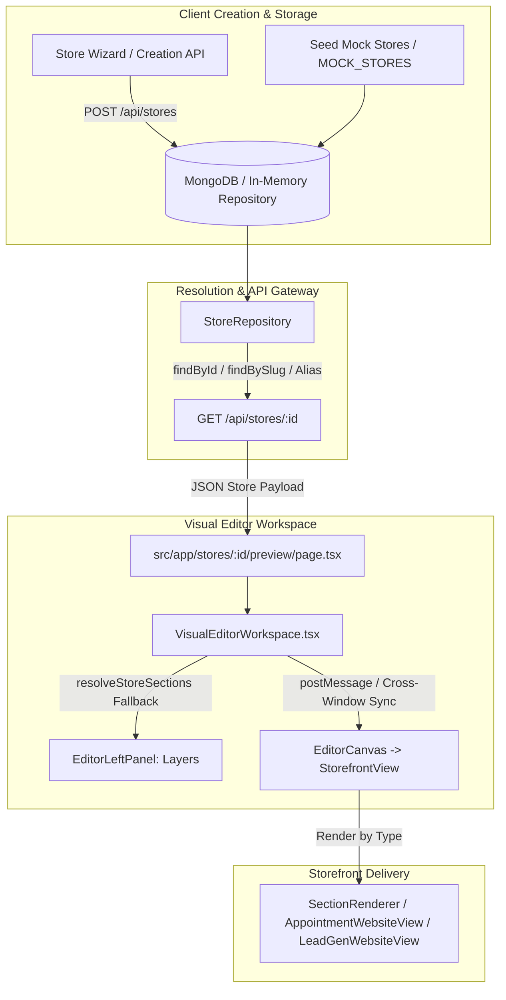

# GridRetail — Phase 18.1 Existing Architecture Audit

**Author:** GridRetail Engineering  
**Date:** November 23, 2026  
**Scope:** Complete architectural data-flow, store resolution, editor synchronization, and multi-tenant website generation audit for Phase 18.1.

---

## 1. Executive Summary

GridRetail is an enterprise website-generation platform designed to generate high-converting, tailored client websites across three primary modalities:
1. **E-Commerce Storefronts** (Catalog, SKU showcases, shopping cart, checkout)
2. **Appointment Scheduling Websites** (Consultation booking, time-slot selection, practitioner profiles, cancellation policies)
3. **Lead Generation Websites** (Strategic inquiry forms, consultation capture, value propositions, assessment requests)

This architecture audit examines the end-to-end data pipeline from store creation to editor workspace rendering. It investigates and documents the precise root causes behind reported platform defects:
- The `Store record not found` error preventing appointment and lead-generation builders from loading.
- The editor layers discrepancy where the left panel displayed `Page Structure: 0 Sections` while the iframe canvas rendered a complete storefront.
- The versioning mismatch between `AppSidebar` (`v5.0.0`) and canonical platform configuration (`Version 1.0.0`).
- The transparency of browser `localStorage` persistence in platform settings.
- Dashboard table column wrapping and unsupported SLA claims (`100% SLA uptime`).

---

## 2. End-to-End Architectural Data Flow

### 2.1 Store Creation to Repository
When a store is initialized via the store generation wizard (`/stores/new`) or seeded via `MOCK_STORES`, it receives a canonical `id` (e.g., `str_01`, `str_07`, `str_08`), a unique URL slug (`aura-minimalist`, `summit-legal`, `apex-growth`), and a `websiteType` (`ecommerce`, `appointments`, or `lead_gen`).

### 2.2 Store Resolution via API Gateway
Clients and internal navigation links request store data via `GET /api/stores/[id]`.
- Prior to Phase 18.1, `/api/stores/[id]` invoked strictly `StoreRepository.findById(id)`.
- If an internal component or external caller passed a store slug (e.g., `summit-legal` or `apex-growth`) or a legacy alias (e.g., `str_summit` or `str_apex`), `findById` returned `null`, producing an HTTP 404 response.

### 2.3 Visual Editor Synchronization
Once loaded in `StoreCustomizerPreviewPage`, the store object is passed to `VisualEditorWorkspace`.
- Prior to Phase 18.1, `VisualEditorWorkspace` initialized its `sections` state with `store.sections || []`.
- If `store.sections` was undefined (as was the case for mock stores where sections are dynamically resolved), `sections` became an empty array `[]`.
- Consequently, `EditorLeftPanel` rendered `Page Structure (0 Sections)`, while the iframe canvas rendered all 5 default sections resolved via `resolveStoreSections(store)`.

---

## 3. Root Cause Analysis

### 3.1 Store Resolution Defect (Priorities 1 & 2)
1. **ID Discrepancy in Navigation Links:**
   - In `GlobalSpotlightModal.tsx` and legacy test scripts, static fallback entries hardcoded `str_summit` and `str_apex` instead of the canonical IDs `str_07` and `str_08`.
2. **Missing Slug and Alias Resolution in Route Handlers:**
   - `src/app/api/stores/[id]/route.ts` only evaluated `StoreRepository.findById(id)`.
   - It lacked fallback logic to `StoreRepository.findBySlug(id)`.
   - When navigation linked to `/stores/str_summit/preview` or `/stores/summit-legal/preview`, the API route threw a 404, prompting `Storefront Editor Unavailable — Store record not found`.

### 3.2 Editor Section Discrepancy (Priority 3)
1. **Asymmetric Initialization:**
   - The preview canvas (`StorefrontView` and `/store/[slug]`) invoked `resolveStoreSections(store)` on render, synthesizing 5 default section instances if `store.sections` was empty.
   - The editor workspace (`VisualEditorWorkspace.tsx`) initialized state with `useState<SectionInstance[]>(store.sections || [])`.
   - Because `store.sections` was undefined on seeded stores, the editor layers tree remained completely empty (`0 Sections`), breaking bidirectional layer management until manually added.

### 3.3 Platform Version Inconsistency (Priority 10)
- In `src/components/layout/AppSidebar.tsx` line 180, an environment badge hardcoded `v5.0.0`.
- In `src/config/site.ts` and `src/components/layout/AppShell.tsx`, the canonical platform version was defined as `1.0.0` (`Version 1.0.0`).
- This created visual confusion between experimental component versioning and the platform release version.

### 3.4 Platform Settings Persistence Ambiguity (Priority 9)
- `src/app/settings/page.tsx` persisted general workspace name and default expiry exclusively in browser `localStorage`.
- While appropriate for demo workstation preference overrides, the UI lacked explicit labeling, implying server-wide persistence across sessions and devices.

### 3.5 Dashboard Table Layout & SLA Claims (Priority 7)
- `RecentStoresTable.tsx` and `stores/page.tsx` lacked minimum column constraints (`min-w-*`), causing badges, dates, and client names to wrap abruptly on smaller desktop/tablet resolutions.
- In `MetricCards.tsx`, the Published Stores card featured `delta: "100% SLA uptime"`. GridRetail is an internal demo and pitching platform; hardcoded enterprise SLA guarantees are unverified and misleading.

---

## 4. Remediation Plan

1. **Dual-Key Store Resolution:**
   - Update `StoreRepository.findById` and `src/app/api/stores/[id]/route.ts` to resolve stores by ID, slug, and legacy alias map (`str_summit` -> `str_07`, `str_apex` -> `str_08`).
   - In `PATCH /api/stores/[id]`, ensure updates are applied to the canonical resolved ID.
2. **Unified Section Resolver in Editor:**
   - In `VisualEditorWorkspace.tsx`, initialize `sections` using `store.sections && store.sections.length > 0 ? store.sections : resolveStoreSections(store)`.
   - Explicitly seed default `sections` arrays on all mock stores in `src/mock/stores.ts`.
3. **Canonical Version Centralization:**
   - Update `AppSidebar.tsx` to read directly from `siteConfig.version` (`v${siteConfig.version}`).
4. **Settings Transparency:**
   - Explicitly label client-side workspace preferences as "Local Browser Storage" in `src/app/settings/page.tsx`.
5. **Dashboard Polish:**
   - Replace `100% SLA uptime` in `MetricCards.tsx` with `Active environments`.
   - Apply robust responsive column widths and `whitespace-nowrap` to table headers and badges in `RecentStoresTable.tsx` and `stores/page.tsx`.

---

## 5. Architectural Verification Matrix

| Component | Pre-Phase 18.1 Behavior | Phase 18.1 Target Behavior | Verification Mechanism |
| :--- | :--- | :--- | :--- |
| `GET /api/stores/:id` | 404 on slug or alias | Resolves ID, slug, and alias seamlessly | Unit test + HTTP probe |
| Appointment Editor | "Store record not found" | Loads Summit Legal Practice with full controls | Playwright automated capture |
| Lead Gen Editor | "Store record not found" | Loads Apex Growth Advisory with full controls | Playwright automated capture |
| E-Commerce Layers | "Page Structure (0 Sections)" | "Page Structure (5 Sections)" matching canvas | Playwright automated capture |
| AppSidebar Version | Hardcoded `v5.0.0` | Canonical `v1.0.0` matching footer | Layout test + Browser review |
| MetricCards Delta | "100% SLA uptime" | "Active environments" | Text assertion test |
