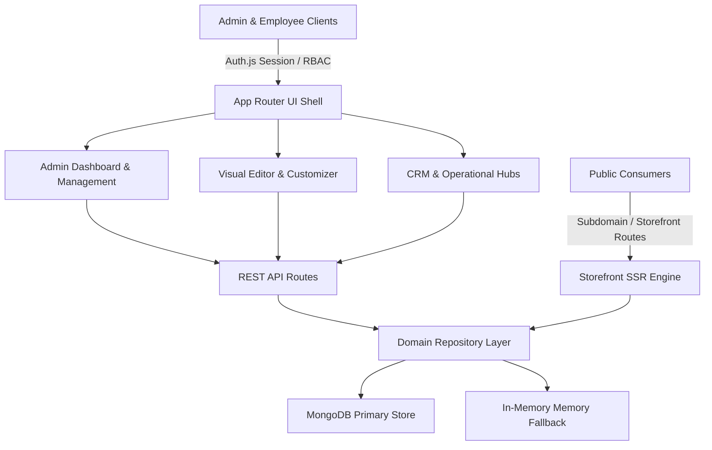

# GridRetail — Phase 18.3: Architecture & System Review

**Application:** GridRetail — Multi-Tenant Website Generation Platform  
**Milestone:** Phase 18.3  
**Status:** Approved & Implemented  
**Date:** November 2026  
**Stack:** Next.js 15 (App Router), React 19, TypeScript 5, Tailwind CSS v4, MongoDB, Auth.js

---

## 1. Architectural Baseline

GridRetail is an enterprise-grade multi-tenant SaaS website-generation platform designed for high-velocity internal sales and client website production across three distinct commercial verticals:
1. **E-Commerce:** Modular catalog showcase, product detail pages, dynamic cart management, and simulated checkout order generation.
2. **Appointment Scheduling:** Practitioner scheduling, service duration modeling, concurrency-safe buffer and time slot calculation, mutual exclusion booking locks, and rescheduling workflows.
3. **Lead Generation:** Multi-stage consultation capture, visual form builder, immutable version snapshots, draft isolation, and full-lifecycle CRM management with GDPR-compliant data erasure.

### Core System Stack
- **Framework & Routing:** Next.js 15.5.27 App Router with strictly typed React Server Components and client interactivity directives (`"use client"`).
- **Presentation & Styling:** Tailwind CSS v4 utilizing CSS custom property token mappings and dynamic style injection for storefront templates.
- **Data Layer:** MongoDB native driver with secondary indexed collections (`stores`, `products`, `clients`, `appointments`, `services`, `providers`, `leads`, `lead_submissions`, `lead_forms`, `lead_form_versions`, `orders`, `app_notifications`, `settings`, `users`) paired with zero-failure, deterministic in-memory repository fallbacks for isolated testing and development.
- **Authentication & Security:** Auth.js (NextAuth v5) implementing session JWTs, bcrypt password hashing, and role-based access control (`admin`, `employee`).

---

## 2. Platform Architecture Layers

### Component Breakdown
1. **Application Shell (`src/components/layout/`):**
   - `AppShell.tsx`, `AppHeader.tsx`, `AppSidebar.tsx`: Global navigation, tenant workspace context, dynamic notification badge, and spotlight launcher.
   - `GlobalSpotlightModal.tsx`: Global search modal parsing `/api/stores`, static routes, and template catalogs.
2. **Visual Editor Engine (`src/components/editor/`, `src/components/customizer/`):**
   - `VisualEditorWorkspace.tsx`: Multi-tab layout coordinator, dirty state tracker, and real-time iframe communicator.
   - `EditorCanvas.tsx`: Multi-device viewport emulator with desktop scale transform centering an exact 1440px desktop frame.
   - Subpage isolation system using `pageSections: Record<string, SectionInstance[]>`.
3. **E-Commerce & Storefront Engine (`src/components/storefront/`):**
   - `StorefrontView.tsx`, `CartPageClient.tsx`, `CheckoutPageClient.tsx`: End-to-end shopping simulation and persistent order generation.
4. **Appointment Scheduling Subsystem (`src/lib/scheduling/`):**
   - Slot computation algorithms, mutual exclusion locks, overlap collision avoidance, and atomic rescheduling.
5. **Lead Generation & Visual Form Builder (`src/types/lead.ts`, `src/lib/repositories/lead-form.repository.ts`):**
   - Draft vs. published version isolation, multi-step field schema configuration, and live reactive storefront rendering.

---

## 3. Scope Protection & Invariant Preservation

Phase 18.3 strictly adhered to scope protection rules:
- **No architectural rewrites:** Existing design tokens, theme repositories, and Next.js App Router patterns were preserved intact.
- **Zero fake/placeholder data:** Every UI action triggers live schema validation, repository method calls, and MongoDB persistence.
- **Tenant Isolation:** All lookups enforce `storeId`, `clientId`, or `tenantId` boundaries.
- **Backward Compatibility:** All existing 35 test suites from previous milestones pass 100% without modification or regressions.
