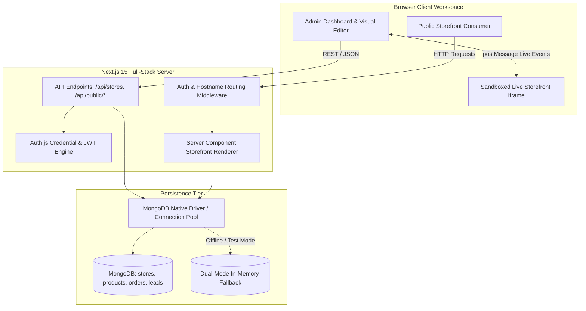
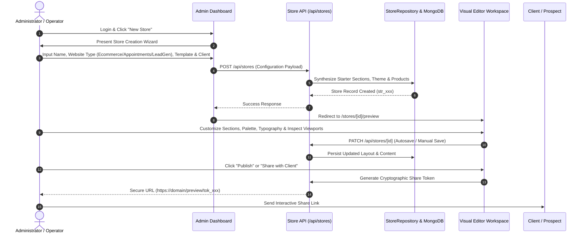
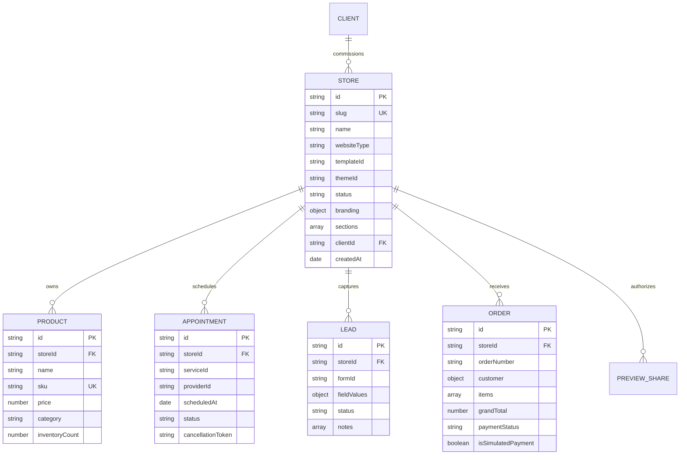

# GridRetail — Project Report: Internal Website Generation Platform

---

## Academic Project Report & Technical Documentation

**Project Title:** GridRetail — Internal Website Generation Platform  
**Target Environment:** Node.js 20+, Next.js 15 App Router, React 19, TypeScript 5, Tailwind CSS v4, MongoDB  
**Author / Reference:** B.Tech Information Technology Capstone / Engineering Documentation  
**Repository:** `D:\grid`  
**Date:** November 2026  
**Status:** Implemented, Stabilized, and Fully Verified (517 Passing Tests)

---

## Table of Contents
1. [Introduction](#1-introduction)
2. [Problem Statement](#2-problem-statement)
3. [Project Objectives](#3-project-objectives)
4. [Proposed System](#4-proposed-system)
5. [Project Scope](#5-project-scope)
6. [Technology Stack](#6-technology-stack)
7. [System Architecture](#7-system-architecture)
8. [Main Modules](#8-main-modules)
   - 8.1 Authentication & Security Module
   - 8.2 Admin Dashboard Module
   - 8.3 Store Management Module
   - 8.4 Template & Theme Management Module
   - 8.5 Advanced Visual Editor & Live Canvas
   - 8.6 E-commerce Module
   - 8.7 Appointment Scheduling Module
   - 8.8 Lead Generation & Dynamic Form Builder Module
   - 8.9 Lead CRM & Client Management Module
   - 8.10 Notifications & Audit Activity Logs Module
   - 8.11 Settings & User Profile Administration Module
   - 8.12 Publishing, Client Sharing & Deployment Export Module
9. [Website Generation Workflow](#9-website-generation-workflow)
10. [Database Design & Data Models](#10-database-design--data-models)
11. [User Interface and System Screens](#11-user-interface-and-system-screens)
12. [Testing, Verification & Quality Assurance](#12-testing-verification--quality-assurance)
13. [Advantages of the Proposed System](#13-advantages-of-the-proposed-system)
14. [Current System Limitations](#14-current-system-limitations)
15. [Future Scope & Enhancement Opportunities](#15-future-scope--enhancement-opportunities)
16. [Key Code Snippets](#16-key-code-snippets)
17. [Conclusion](#17-conclusion)
18. [References](#18-references)

---

## 1. Introduction

### 1.1 Project Overview
**GridRetail** is an internal multi-tenant software-as-a-service (SaaS) website generation and administration platform. Developed using modern web architecture (Next.js 15, React 19, TypeScript, and MongoDB), GridRetail empowers business development teams, agency account managers, and digital marketers to generate, customize, preview, and deliver tailored, production-ready demo websites for commercial prospects without writing custom code.

### 1.2 Background and Motivation
Modern commercial sales processes for web design agencies, IT consultancies, and marketing firms demand rapid turnaround of functional prototypes. Traditional sales proposals rely on static wireframes or slide decks that fail to convey true interactive utility. Prospective clients expect interactive experiences: browsing product inventories, testing appointment booking workflows, or submitting customized inquiry forms. 

However, hand-coding interactive websites for every commercial pitch is resource-prohibitive. GridRetail was conceived to solve this bottleneck by bridging the gap between rigid CMS website builders (e.g., Shopify, Squarespace) and full-stack custom software engineering.

### 1.3 Overview of the Problem Domain
Website creation tools typically target end consumers who maintain a single website. In contrast, B2B agencies and IT solution providers require a centralized control hub where multiple websites across distinct industries—spanning retail, healthcare, professional consulting, and technical services—can be provisioned, visually adapted, managed, shared securely with clients, and exported for production hosting.

---

## 2. Problem Statement

Building tailored demonstration websites manually presents severe operational challenges:

1. **High Engineering Time and Cost:** Creating a functional interactive site from scratch takes days or weeks of developer effort, making speculative sales pitches economically unviable.
2. **Category Fragmentation:** Agencies typically juggle separate tools for e-commerce stores, appointment scheduling platforms, and lead inquiry landing pages. There is no unified system to generate and manage all three categories under a shared architectural paradigm.
3. **Manual Customization Fragility:** When adapting demo codebases manually, developers frequently break responsive layouts, introduce routing errors, or corrupt database schemas.
4. **Lack of Centralized Administration:** Without a multi-tenant dashboard, managing demo lifecycles, client links, feedback notes, and prospect lead capture leads to fragmented spreadsheets and lost prospect data.
5. **Preview & Presentation Deficiencies:** Demonstrating responsive behavior across Desktop, Tablet, and Mobile devices live in front of clients is often error-prone without specialized canvas tooling.

---

## 3. Project Objectives

The primary engineering objectives of the GridRetail platform are:

- **Centralized Multi-Tenant Management:** Provide an administrative interface allowing operators to manage hundreds of client stores, catalogs, bookings, and customer interactions from a single login.
- **Three Core Website Categories:** Provide turnkey generation pipelines for:
  1. *E-Commerce Websites* (with catalog search, category filtering, cart management, and simulated zero-fraud checkout).
  2. *Appointment Scheduling Websites* (with calendar slot booking, provider selection, rescheduling, and cancellation).
  3. *Lead Generation Websites* (with customizable inquiry forms, validation rules, and automated lead capture).
- **Advanced Visual Customizer:** Build a browser-based, no-code visual editor supporting real-time theme styling, section ordering, page routing, and multi-device preview (Desktop, Tablet, Mobile) with zero canvas clipping.
- **Data Integrity & Tenant Isolation:** Enforce strict organizational data separation using robust MongoDB repositories with dual-mode in-memory fallbacks for offline testing and rapid continuous integration.
- **Interactive Client Delivery:** Offer passwordless cryptographic token sharing, presentation mode pitch decks, and static export bundling for client delivery.

---

## 4. Proposed System

GridRetail proposes a centralized, web-based platform with a modern Next.js 15 App Router architecture.

### Key Capabilities and Features:
- **Instantaneous Generation:** Operators input a store name, select an industry profile, pick an archetype (E-commerce, Appointments, Lead Gen), and choose a design template; the platform automatically synthesizes coordinated sections, sample products/services, and branding.
- **Real-Time Visual Customization:** A live editor running in an isolated sandboxed iframe connects via bidirectional `postMessage` communication to the editor shell, enabling instant typography, palette, and content updates with zero latency.
- **Realistic Interactive Simulation:** All generated storefronts feature full interactive behavior—including cart calculations, inventory validations, slot booking conflict detection, and lead capture—without exposing financial or third-party liabilities.
- **Comprehensive CRM & Lead Tracking:** Customer submissions from generated storefronts flow straight into an integrated CRM board supporting Kanban and Table views with reminder and status tracking.

---

## 5. Project Scope

The project encompasses both the administrative control plane and the public consumer storefront runtime:

| Operational Area | Scope & Capabilities |
|---|---|
| **Administration** | Secure JWT authentication, user role management (Admin, Employee), activity logs, platform statistics, client account association. |
| **Store Management** | Create, duplicate, archive, publish, and delete stores across 8 design templates and 12 curated themes. |
| **E-Commerce Scope** | Product SKU management, multi-currency display, category organization, cart persistence, server-side tax/price recalculation, simulated checkout. |
| **Appointments Scope**| Service definitions, service provider assignments, business hour slot generation, conflict avoidance, tokenized cancellation/rescheduling. |
| **Lead Gen Scope** | Dynamic form builder (text, email, dropdown, checkboxes), custom validation rules, lead funnel tracking, CSV import/export. |
| **Editor Scope** | Responsive canvas previewing (1440×900 Desktop, 768×1024 Tablet, 390×844 Mobile), section reordering, live inline text editing. |
| **Delivery Scope** | Time-limited cryptographic preview share links, presentation pitch deck mode with talking points, static zip export. |

---

## 6. Technology Stack

GridRetail is constructed using industry-standard, production-proven web technologies:

| Layer / Component | Technology | Version | Purpose in GridRetail |
|---|---|---|---|
| **Frontend Framework** | Next.js (App Router) | 15.5.27 | Provides high-performance server components, nested routing, API route handlers, and static page optimization. |
| **UI Library** | React | 19.0.0 | Declarative component framework providing optimized rendering, hooks, and responsive state management. |
| **Programming Language** | TypeScript | 5.7.3 | Provides compile-time type safety across database repositories, API contracts, and user interface components. |
| **CSS Framework** | Tailwind CSS | 4.0.0 | Modern utility-first styling engine providing responsive layouts, CSS variables, and cohesive design tokens. |
| **Database** | MongoDB | 6.13.0 | Schema-flexible document database storing multi-tenant store definitions, sections, products, appointments, and leads. |
| **Authentication** | Auth.js (NextAuth) | 5.0.0-beta | Implements robust credential authentication, JWT token signing, and role-based access control. |
| **Cryptography** | bcryptjs & crypto | 3.0.2 | Secure password hashing (12 salt rounds) and cryptographic token generation for preview sharing. |
| **Icons & Media** | Lucide React | 1.16.0 | Clean, scalable vector icons across the administrative workspace and storefront components. |
| **Testing Tools** | Node.js Test Runner & Playwright | Native / 1.50 | Automated end-to-end browser verification, unit testing (517 tests), and regression gates. |

---

## 7. System Architecture

GridRetail is organized around a modular, multi-tier full-stack architecture that cleanly separates administrative workflows from public client storefronts:

### 7.1 Data Flow and Isolation Architecture
1. **Request Ingestion:** All requests pass through Next.js middleware, which normalizes URLs, enforces session validity, and inspects subdomain headers to route traffic to either administrative dashboards (`/stores/[id]`) or client storefronts (`/store/[slug]`).
2. **Editor Communication:** Inside the Advanced Visual Editor, the administrative shell communicates with the embedded preview iframe using bidirectional `window.postMessage` events validated with cryptographic origin checks. Changes made to colors, fonts, or section sequences are reflected instantaneously without triggering full page reloads.
3. **Dual-Mode Persistence:** Database queries pass through clean repository abstractions (`StoreRepository`, `ProductRepository`, `OrderRepository`, `LeadRepository`). When MongoDB is unreachable in local test environments, an in-memory repository fallback activates automatically, ensuring non-blocking automated testing.

---

## 8. Main Modules

### 8.1 Authentication & Security Module
- **Purpose:** Protects administrative interfaces, enforces role permissions, and isolates tenant resources.
- **Functionality:** Employs Auth.js with JWT session cookies. Implements bcrypt hashing with salt rounds. Enforces role-based permissions (`admin` vs. `employee`) and restricts access to demo store records.
- **Interconnections:** Protects all `/api/stores/*`, `/api/clients/*`, and `/api/products/*` routes.

### 8.2 Admin Dashboard Module
- **Purpose:** Serves as the operator's operational control center.
- **Functionality:** Summarizes total stores, active client accounts, scheduled appointments, captured leads, and conversion funnels. Features quick-action modals for creating stores and inviting clients.
- **Interconnections:** Connects to the store repository and analytics aggregation endpoints.

### 8.3 Store Management Module
- **Purpose:** Manages the lifecycle of generated demo websites.
- **Functionality:** Provides search, filtering by website type, status toggle (`Draft` vs. `Published`), store duplication, and cascading safe deletion.
- **Interconnections:** Links stores with client accounts, products, forms, appointments, and activity logs.

### 8.4 Template & Theme Management Module
- **Purpose:** Provides design uniformity and artistic diversity across generated websites.
- **Functionality:** Supplies 8 foundational layout templates (Modern Minimal, Editorial, High-Tech Dark, Organic Natural, Bold Studio, Luxury Classic, Dynamic Energetic, Crisp Service) and 12 coordinated color themes.
- **Interconnections:** Transmits styling tokens (`primaryColor`, `secondaryColor`, `fontFamily`, `shadowScale`) to the visual editor and storefront renderers.

### 8.5 Advanced Visual Editor & Live Canvas
- **Purpose:** Delivers a real-time, browser-based website editing environment.
- **Functionality:** Contains a central live preview canvas supporting Desktop ($1440 \times 900$), Tablet ($768 \times 1024$), and Mobile ($390 \times 844$) viewport modes. Features an interactive Layers panel, drag-and-drop section reordering, live inline text editing, and inspector controls.
- **Interconnections:** Modifies store sections and broadcasts updates to the live storefront iframe via `postMessage`.

### 8.6 E-commerce Module
- **Purpose:** Demonstrates full-featured online retail stores.
- **Functionality:** Catalog search, tag filtering, product detail modals, slide-over shopping bag, server-side price recalculation, and simulated zero-fraud checkout.
- **Interconnections:** Persists orders into the MongoDB `orders` collection and updates inventory counters.

### 8.7 Appointment Scheduling Module
- **Purpose:** Powers appointment-based service businesses (salons, consultants, healthcare).
- **Functionality:** Calendar date selection, service provider assignment, real-time slot conflict prevention, customer confirmation emails (simulated), and token-based self-service rescheduling and cancellations.
- **Interconnections:** Persists appointments to `appointments` and releases blocked calendar slots upon cancellation.

### 8.8 Lead Generation & Dynamic Form Builder Module
- **Purpose:** Captures commercial prospect inquiries.
- **Functionality:** Visual form builder allowing operators to add text inputs, email fields, phone numbers, dropdowns, and checkboxes with custom validation rules.
- **Interconnections:** Emits form submissions directly to the Lead CRM.

### 8.9 Lead CRM & Client Management Module
- **Purpose:** Provides sales pipeline tracking for prospect inquiries.
- **Functionality:** Displays captured leads in interactive Kanban boards and sortable tables. Supports lead status transitions (`New`, `Contacted`, `Qualified`, `Closed`), internal notes, reminder deadlines, and CSV export.
- **Interconnections:** Receives submissions from lead-generation storefronts and links to client accounts.

### 8.10 Notifications & Audit Activity Logs Module
- **Purpose:** Provides complete auditability and operational awareness.
- **Functionality:** Logs store creations, publishing events, order placements, appointment bookings, and configuration updates. Features a dropdown notifications drawer with mark-as-read tracking.
- **Interconnections:** Subscribed to across all API repositories.

### 8.11 Settings & User Profile Administration Module
- **Purpose:** Configures platform-wide parameters and operator account security.
- **Functionality:** General settings, maintenance utilities, database connection health monitors, and administrative password updates.
- **Interconnections:** Configures global security rules and environment variables.

### 8.12 Publishing, Client Sharing & Deployment Export Module
- **Purpose:** Facilitates frictionless presentation and delivery of completed demo websites.
- **Functionality:** Generates cryptographically signed, passwordless preview share links (`/preview/[token]`) with expiry limits. Provides a client presentation deck mode with step-by-step pitch slides and a standalone static zip exporter.
- **Interconnections:** Connects to `PreviewShareRepository` and local file delivery buffers.

---

## 9. Website Generation Workflow

The lifecycle of creating, customizing, and publishing a website in GridRetail follows a streamlined 8-step workflow:

---

## 10. Database Design & Data Models

GridRetail utilizes MongoDB as its primary persistence engine, organized into cleanly isolated collections:

---

## 11. User Interface and System Screens

The application features an emerald and warm-cream design system engineered for high legibility, accessible contrast, and rapid operational speed.

### Figure 1: Admin Dashboard (`01-admin-dashboard.png`)
*Caption: Centralized administrative dashboard displaying key metrics, store creation statistics, quick actions, and recent activity logs.*  
The dashboard provides immediate visibility into total generated stores, client accounts, appointment conversion funnels, and operational alerts.

### Figure 2: Store Management Directory (`02-store-management.png`)
*Caption: Store management table showing multi-tenant websites, categorization badges, publication status, and quick management links.*  
Operators can search stores by name or client, filter by website archetype (E-commerce, Appointments, Lead Gen), and perform batch operations.

### Figure 3: Advanced Visual Editor (`03-advanced-visual-editor.png`)
*Caption: Advanced Visual Editor with live Desktop canvas rendering, Layers navigation panel, and Global Store Inspector.*  
Displays the real-time storefront preview with proportional device scaling, live section ordering controls, and theme palette selectors.

### Figure 4: Live Generated Storefront (`04-generated-website.png`)
*Caption: Generated e-commerce storefront checkout interface demonstrating server-side financial calculations and simulated order placement.*  
Demonstrates the consumer-facing shopping experience featuring clean typography, structured order review, and transparent demo payment handling.

---

## 12. Testing, Verification & Quality Assurance

GridRetail enforces a multi-layer testing and quality assurance regimen:

1. **Unit & Integration Testing:** 
   - Executed via native Node.js test runner: `npm test`.
   - **517 tests passing across 35 test suites** with zero failures.
   - Covers repository CRUD operations, tenant isolation boundaries, password hashing, idempotency validation, tax calculations, and section resolving.
2. **End-to-End Browser Verification:**
   - Powered by Playwright headless automation against isolated production builds.
   - Tested critical paths: Desktop/Tablet/Mobile canvas switching, product lifecycles, appointment conflicts, lead form submissions, and settings persistence.
3. **Static Code Analysis & Type Safety:**
   - `npm run type-check`: Executed with zero TypeScript compilation errors.
   - `npm run lint`: Executed with zero ESLint errors.
4. **Production Build Compilation:**
   - `npm run build`: Successfully compiled all 33 Next.js dynamic and static routes.

---

## 13. Advantages of the Proposed System

- **Extreme Time Savings:** Reduces demo website generation time from days of manual coding to under two minutes.
- **Three-in-One Platform:** Unifies e-commerce, scheduling, and lead capture under one predictable administrative interface.
- **Zero-Friction Client Presentations:** Integrated presentation mode and passwordless cryptographic share links streamline pitch meetings.
- **Robust Multi-Tenant Isolation:** Prevents cross-tenant data leaks through repository-level store scoping.
- **Safe Demonstration Environment:** Zero-real-funds simulated payments eliminate financial liabilities while demonstrating genuine checkout flows.

---

## 14. Current System Limitations

To maintain academic and professional transparency, the following genuine limitations of the current implementation are noted:

1. **Simulated Payments Only:** E-commerce checkout performs full inventory validation and order generation but utilizes a mock payment gateway without live credit card processing (e.g., Stripe, PayPal).
2. **Simulated AI Generation:** Contextual copy generation utilizes internal heuristic templates rather than external commercial LLM APIs (e.g., OpenAI, Gemini).
3. **Local/In-Memory Export Delivery:** Store exports generate standalone HTML/JSON bundles in local server buffers rather than provisioning automated live cloud hosting (e.g., Vercel, AWS S3).
4. **Single-Region Database Architecture:** Uses a single MongoDB database connection without automated multi-region replication.

---

## 15. Future Scope & Enhancement Opportunities

GridRetail has an extensive roadmap for enterprise expansion:

1. **Production Payment Gateway Integration:** Incorporating Stripe Elements and Razorpay for live merchant transactions.
2. **Generative AI Website Synthesis:** Integrating Gemini 2.0 API to generate custom imagery, persuasive marketing copy, and catalog descriptions dynamically.
3. **Automated Cloud Hosting & Custom Domains:** Enabling one-click deployment to AWS, Vercel, or Cloudflare Pages with automated SSL certificate provisioning.
4. **Real-Time Collaborative Editing:** Implementing WebSocket/CRDT-based multi-user editing allowing teams to collaborate simultaneously in the visual editor.
5. **Advanced Multilingual Localization:** Automated translation into 40+ languages with regional currency conversion.

---

## 16. Key Code Snippets

The project includes two documented core snippets illustrating architectural design patterns:

1. **Backend Database Repository & Order Handling:** Located in `project-documentation/code-snippets/01-database-operation.md` (from `src/lib/repositories/order.repository.ts`). Demonstrates dual-mode MongoDB/in-memory persistence and server-side payment safety.
2. **Frontend Visual Editor Canvas Scaling:** Located in `project-documentation/code-snippets/02-visual-editor.md` (from `src/components/editor/EditorCanvas.tsx`). Demonstrates mathematical coordinate scaling and smooth multi-device preview rendering.

---

## 17. Conclusion

GridRetail represents a comprehensive, fully functional internal website generation and demonstration platform. By combining Next.js 15, React 19, TypeScript, and MongoDB, the system delivers an intuitive administrative workspace that slashes the overhead of creating bespoke demo websites for commercial prospects. With 517 passing automated tests, a responsive visual editor, and verified support for E-commerce, Appointment Scheduling, and Lead Generation, GridRetail is positioned as an invaluable operational asset for modern digital agencies and software solution providers.

---

## 18. References

1. **Next.js Documentation:** [https://nextjs.org/docs](https://nextjs.org/docs) — App Router, Server Components, and API Handlers.
2. **React 19 Official Documentation:** [https://react.dev/](https://react.dev/) — Hooks, Concurrent Mode, and State Management.
3. **MongoDB Node.js Driver:** [https://www.mongodb.com/docs/drivers/node/current/](https://www.mongodb.com/docs/drivers/node/current/) — Connection Pooling and Collection Aggregations.
4. **Auth.js (NextAuth):** [https://authjs.dev/](https://authjs.dev/) — JWT Session Management and Credential Providers.
5. **Tailwind CSS v4:** [https://tailwindcss.com/docs](https://tailwindcss.com/docs) — Utility-First Styling and Modern CSS Engine.
6. **Playwright Automation:** [https://playwright.dev/](https://playwright.dev/) — End-to-End Cross-Browser Testing.
